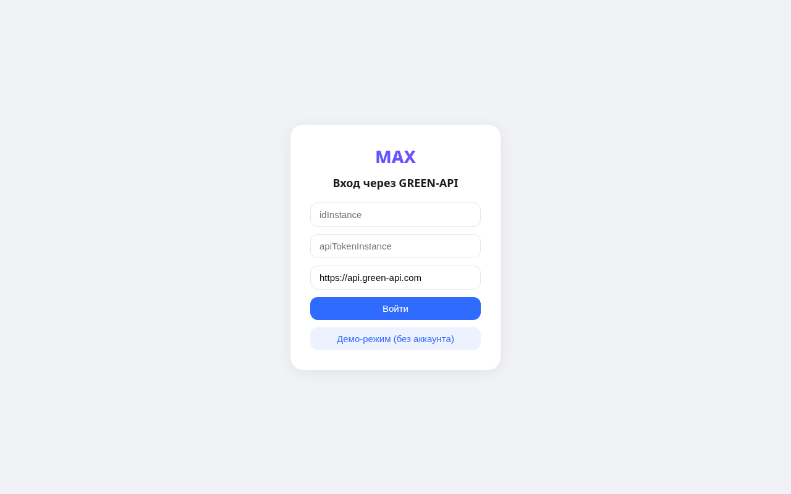
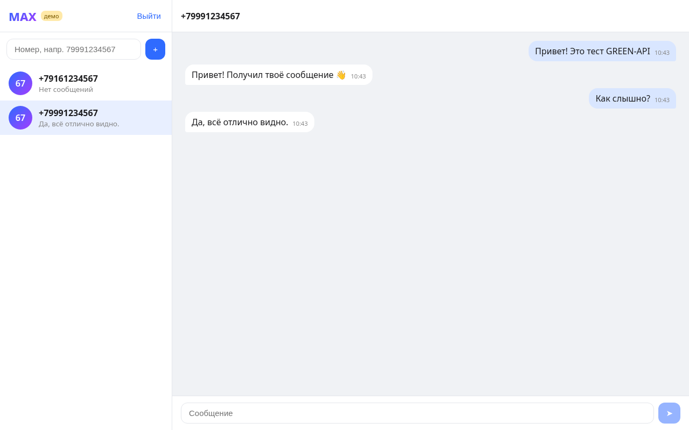
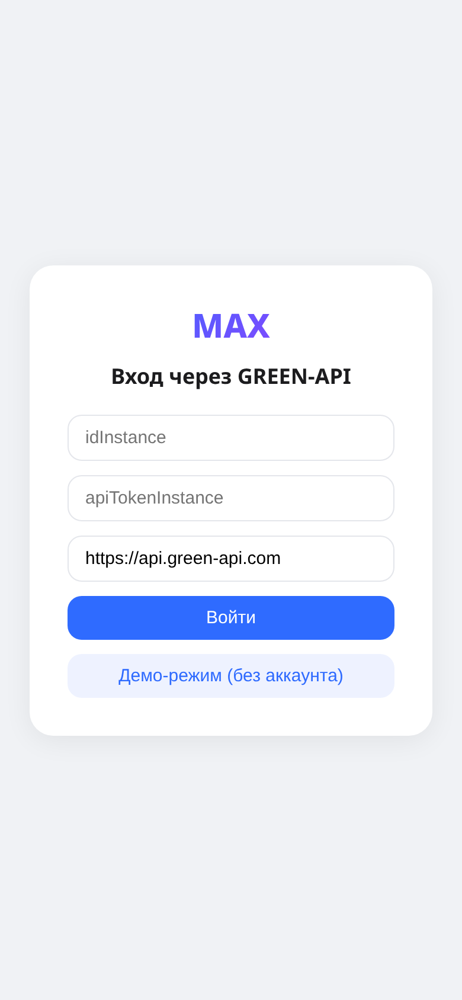
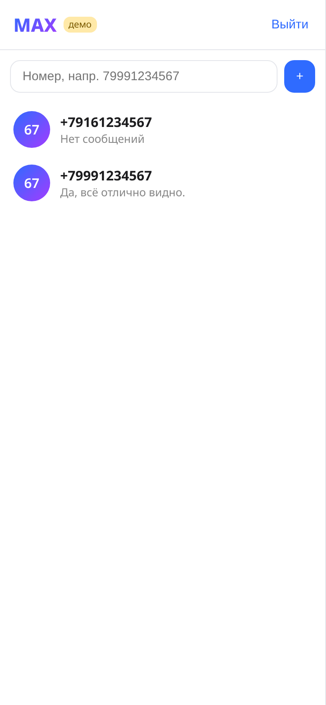
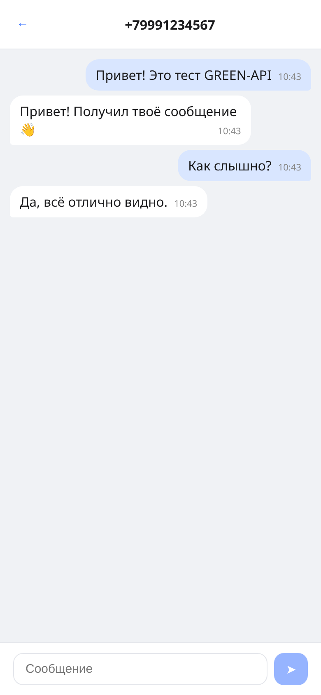

# MAX-чат на GREEN-API

Простой веб-интерфейс (React + TypeScript + Vite) для отправки и получения текстовых сообщений в мессенджере MAX через [GREEN-API](https://green-api.com/max). Внешний вид по мотивам https://web.max.ru/.

## Возможности
- Вход по `idInstance` и `apiTokenInstance` (проверяется методом `getStateInstance`, инстанс должен быть в статусе `authorized`).
- Создание чата по номеру телефона получателя (`79991234567` → `79991234567@c.us`).
- Отправка текста методом [SendMessage](https://green-api.com/v3/docs/api/sending/SendMessage/).
- Получение ответов через [HTTP API](https://green-api.com/v3/docs/api/receiving/technology-http-api/): цикл `ReceiveNotification` (long polling, `receiveTimeout=5`) → обработка → `DeleteNotification`.

## Демо-режим
На экране входа есть кнопка **«Демо-режим (без аккаунта)»**. Она подменяет клиент GREEN-API на локальную имитацию с тем же интерфейсом (`src/api/demoClient.ts`): `getStateInstance` возвращает `authorized`, `sendMessage` — `idMessage`, а через ~2 секунды после каждого отправленного сообщения в очередь попадает уведомление `incomingMessageReceived` с ответом, которое забирается тем же циклом `receiveNotification` → `deleteNotification`. Сеть в демо-режиме не используется, реальный режим работает как прежде.

## Статус проверки
Работа с реальным API (`getStateInstance`, `sendMessage`, `receiveNotification`, `deleteNotification`) реализована по документации GREEN-API для MAX (адреса и формат уведомлений сверены с актуальными страницами документации) и покрыта юнит-тестами с подменой `fetch`, но **не проверялась на живом инстансе** — у автора нет подключённого к GREEN-API аккаунта MAX. Интерфейс проверен в демо-режиме.

В MAX `senderData.chatId` входящего сообщения может быть числовым id, а не `телефон@c.us`, поэтому ответ сопоставляется с открытым чатом по `senderData.senderPhoneNumber`.

## Запуск локально
Нужен Node.js 20+.
```bash
npm install
npm run dev      # http://localhost:5173
npm test         # юнит-тесты (Vitest)
npm run build    # production-сборка в dist/
```

## Настройка инстанса (для реального режима)
1. Создайте инстанс MAX в [личном кабинете GREEN-API](https://console.green-api.com) и авторизуйте его.
2. Включите получение уведомлений о входящих сообщениях. Если у инстанса задан `webhookUrl`, очистите его — иначе уведомления не попадут в очередь HTTP API.
3. В приложении введите `idInstance`, `apiTokenInstance` и `apiUrl` (по умолчанию `https://api.green-api.com`, возьмите значение из кабинета).

Данные входа хранятся только в `sessionStorage` браузера и никуда, кроме GREEN-API, не отправляются.

## Скриншоты (демо-режим)
| Вход | Список чатов | Переписка |
|---|---|---|
|  |  |  |
|  |  |  |

## Структура
```
src/api/greenApi.ts    клиент GREEN-API (sendMessage, receive/deleteNotification, разбор уведомлений)
src/api/demoClient.ts  имитация GREEN-API для демо-режима
src/lib/phone.ts       номер телефона ↔ chatId
src/Login.tsx          форма входа
src/Chat.tsx           список чатов, переписка, поле ввода, опрос уведомлений
```
